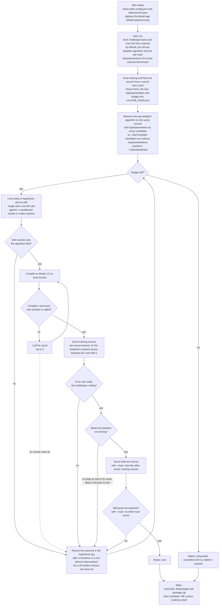

# How Talos works

What a job does from `talos run` to the hand-back package, and the rules that keep a
candidate's score comparable with the baseline's. For setup and the commands, see
[README.md](../README.md). For the three compute backends, see
[compute-backends.md](compute-backends.md).

The design reasoning is in
[docs/ai/specs/2026-09-11-talos-design.md](ai/specs/2026-09-11-talos-design.md). That
directory is not kept in step with the code; where it disagrees with this document, the
README or the code, it is out of date.

## The research loop

A stopped job can be resumed with `talos run --resume`. An `exhausted` one resumes only with
added budget (`--add-*`): `talos/extend.py::extend` records the extension in
`state.budget_extensions`, and every budget check reads `talos/budget.py::effective_budget`,
the job's original budget plus its extensions. `job.json` is not rewritten.

Baseline and candidates are always scored on the same nonces, fuel and hardware class, and
on the same hyperparameters except in a `--start template` job, so the delta between them
measures the edit and nothing else. In a template job the candidates run without
hyperparameters while the baseline keeps the mainnet map (see
[Template start](#template-start)), so the delta there also includes the effect of those
values on the baseline. The
`rand_hash` that seeds the nonces is never shown to the LLM, so it cannot tune to the exact
nonces it is scored on.

"Beats the baseline" (`talos/scoring.py::beats`) means the mean relative delta across tracks
is above the challenge's `BeatRule.margin`, no track is worse than the baseline, and the error
rate is under the challenge's ceiling. The default margin is 0, so any improvement wins and a
tie does not; per-challenge rules live in `talos/challenges.py`. With `--track`, the focus
track must be above the margin and no other track may get worse (`beats_focused`).

## From-scratch start and annealing search

`talos run` takes three flags that change where the search starts and which candidate it edits
next: `--start {mainnet,template}`, `--search {greedy,anneal}` and `--chains N`. With the defaults
(`mainnet`, `greedy`, 1) the search makes the same decisions as before these flags existed:
it edits the job's best, and the win rule is unchanged. The prompts do change for every job:
the hypothesis asks for a `design_family`, and the "current best" sentence is replaced by the
gap of the parent and of the best to the mainnet baseline. The tree lives in `state.json` as `nodes`
and `chains` (`talos/lineage.py::Node`, `talos/lineage.py::Chain`), and the three settings are
frozen in `job.json`; a resume with a different value is refused.

### Template start

`--start template` supports `energy_arbitrage` only. The root of every chain is TIG's empty
template (`talos/loop.py::Loop._root_files`), and a candidate has exactly one file, `mod.rs`.
The LLM sees the challenge's `README.md` and non-baseline source files at the pinned monorepo
commit (`talos/challenges.py::TEMPLATE_START_FILES`) plus the template, never the baseline's
code. The baseline is still measured, with the mainnet hyperparameters, and candidates run with
none (`talos/loop.py::Loop._candidate_hyperparameters`); see AGENTS.md invariants 1 and 2. In
single-shot mode the first candidate of a chain, and any candidate whose hypothesis names a
design family that no node on the chain has used, is written as a whole file
(`talos/loop.py::Loop._whole_file`); other edits are search/replace blocks. Codex agentic is
refused (`talos/agentic.py::codex_agentic_refused`).

### Chains and the accept rule

Chains take turns: iteration n runs on chain (n-1) mod N (`talos/lineage.py::chain_for`).
Concurrency is a later change. Greedy edits a chain's best node; anneal edits its current node.
A candidate that improves on the job's best always becomes the chain's best. Otherwise, under
`--search anneal` (`talos/loop.py::Loop._anneal_step`), it is accepted when its score is at
least its parent's, and when it is lower by `drop`, with probability `exp(-drop / T)`
(`talos/lineage.py::decide`). The draw is seeded from the job id, the chain and the iteration
(`talos/lineage.py::draw`), never from `rand_hash`, so a resumed job decides as the original
did. Under greedy with several chains or a template start, a candidate better than its own
chain's best is accepted into the chain without being a job-wide improvement.

In a `--scoring native` job the comparisons between nodes use the score a candidate was produced
with, which is the native score. A candidate that improves on the job's best is still validated
on the metered runtime, and one that fails there is never a chain state. An accepted-worse
candidate is never validated, confirmed or packaged as the result, so "won" means what it meant
before.

### Temperature and reheating

`T = t0 * (1 - (1 - floor) * progress)` (`talos/lineage.py::temperature`), where `progress` is
the largest spent fraction over the capped budget dimensions (`talos/lineage.py::spent_fraction`),
measured from the chain's last reheat. After `stall` iterations on a chain without a new chain
best, the chain returns to its best node and its cooling restarts from `t0` over the budget that
remains (`talos/loop.py::Loop._reheat`). The defaults, `t0 = 0.05`, `floor = 0.1` and
`stall = 5` (`talos/lineage.py::AnnealSettings`), are ESTIMATES: nothing has been measured to
support them.

### What the tree records

Each iteration adds a node with its parent, chain, design family, title, outcome, score, per-track
scores, metered score, whether it was accepted, and for an anneal decision the
probability (empty when acceptance was automatic), draw and temperature. A reheat is a `reheat`
timeline event and an anneal decision an `accept` event. The package writes the tree as
lineage.json and lineage.md; a template job
writes `diff_vs_template.patch` and no `hyperparameters.json`
(`talos/package.py::build_package`).

## Native research scoring

`talos run --scoring native` (the default) changes how research candidates are scored, not how
a winner is decided. With `--scoring metered` every nonce of every candidate runs under
`tig-runtime` with TIG's fuel counter, as the baseline did. It is slow because the build
instruments every dependency's IR and the runtime meters every instruction. In native mode a
candidate is built into the `talos-native` runner (`talos/native_runner.py::render` writes it,
`talos/inside.py::build_native` builds it), which meters no instructions and stops when the
solve has run for a time budget (exit 87). The loop then scores research candidates natively
and only an improving one is scored on the metered runtime.

Some algorithms budget their own work by reading TIG's counter through
`extern "C" { static __fuel_remaining: u64; }` (mainnet's energy_arbitrage `gridflow` and
job_scheduling `ember_stromboli` at the pinned monorepo). The runner defines that symbol
(`talos/native_runner.py::_FUEL`), or their native build would fail to link. It starts at the
job's fuel (`--fuel`). With a budget it falls linearly with elapsed time to zero at the budget,
so such an algorithm winds down inside the budget instead of being cut off by exit 87. With no
budget, in calibration, it stays at the job's fuel. Fuel and time are not the same thing, so
how far a run gets before the algorithm's own fuel check stops it can differ between native and
metered; calibration only counts nonces where both runs reach the same quality.

**Calibration.** A native run has no fuel limit, so a per-track time budget stands in for it.
`talos/loop.py::Loop.calibrate` finds one after the baseline, on every start and resume. The
record is keyed by challenge, hardware class, both pins, the baseline's code, the native
runner's digest and the baseline's hyperparameters
(`talos/calibration.py::calibration_key`); nonce sets are not in the key, so
one record serves later jobs on the same baseline and is cached in `~/.talos/calibration/`.
With no record, Talos scores the baseline's training nonces natively with no budget and
reads the metered fuel from the baseline's stored rows (or, for a baseline cached before fuel
was recorded, from one metered call). For each track the ratio is the median of native
`solve_us` over metered `fuel_consumed` (`talos/calibration.py::track_ratios`). Both numbers are taken at the algorithm's last `save_solution` call, so an algorithm that keeps improving its solution until the limit gives a ratio for the time of its last save.
A nonce enters the median only when both runs are ok, neither hit its limit and both
reached the same quality, since otherwise the two saves are different ones (a metered run
cut off by fuel saved earlier than the unbudgeted native run). The budget is
ratio x the job's fuel x a margin, never below one second
(`talos/calibration.py::budgets_us`). The starting margin is 0.8, a validation that finds a
metered out-of-fuel nonce the native run finished counts a miss for its track, and every third
miss lowers that track's margin by 0.1 to a floor of 0.3
(`talos/calibration.py::record_miss`). The 0.8, the 0.1 step, the 0.3 floor, the limit of 3
misses and the one-second floor are ESTIMATES with no measurement behind them; they are
tuned from the misses the records collect. The record stores the ratio measured when it was
created, plus each track's margin and miss count; it never re-measures the ratio, and the
budget is computed from it and the job's fuel each time. Jobs with the same key share the
record, so every change to it is a load, change and save under an exclusive lock on
`<key>.lock` beside it (`talos/calibration.py::count_validation`,
`talos/calibration.py::create`); a job that measured a record while another stored one keeps
the stored one. Each count also stores a token for the job and iteration, so a resume that
validates the same iteration again, after a kill between the record's save and `state.json`'s,
counts nothing.

**Validation.** A candidate that would become the best natively is first scored on the
metered runtime, on the job's training nonces, by `talos/loop.py::Loop._validate_and_finish`.
`talos/scoring.py::validation_failure` checks, in this order, and the first failure is the
demotion reason: the candidate builds metered (`native_metered_build_mismatch`); no metered
nonce ran out of fuel where the native run stopped at neither its budget nor the per-nonce
timeout (`fuel_proxy_miss`,
`talos/scoring.py::fuel_proxy_misses`); every nonce both paths solved within their limits
has the same quality (`nondeterministic`, `talos/scoring.py::quality_mismatches`; a row
carries `limit_hit` when the solver exited 87, and a limit-cut nonce is never a quality
mismatch); the metered result is scoreable (`unscoreable`); its error rate is under the
challenge's ceiling (`error_ceiling`); and the loop's own improvement rule holds, meaning
its mean delta exceeds the current best's or it beats the baseline (`not_improved`). The
last check is not `beats` alone, so a stepping stone that improves on the best without yet
beating the baseline is kept. A pass makes the candidate the best with its metered results,
and held-out confirmation (`talos/loop.py::Loop._confirm`) runs on the metered path only. A
failure leaves the previous best in place, appends a `demoted` entry to `state.json`'s
`validations`, and counts in the calibration record. In native mode the recall record
carries no native-versus-metered runtime ratio; a validated best gets the metered one.

**Why the verifier uses the unmetered PTX.** For a GPU challenge the native build writes its
own PTX beside the metered one, without `inject_fuel_and_runtime_sig`
(`talos/inside.py::build_native_ptx`), and the native run and `tig-verifier` are given that
file. The metered PTX is instrumented for fuel and is loaded by `tig-runtime`, which the
native runner does not use.

**Fallback and resume.** The job falls back when the baseline fails the metered build during
calibration (a call made only when its stored rows carry no fuel;
`talos/loop.py::Loop._measure_calibration`), when it fails the native build, when no track gets
a ratio, or when a needed track has none. Then the job records `scoring: metered`, emits `calibration_fallback`
with the reason and runs metered for the rest of its life. A resume keeps the job's own
budgets: `Loop.calibrate` does not re-derive them once set, because another job may have
tightened the record since and a changed budget changes the request of a C3 job still
running. A calibration interrupted between its metered and native calls keeps the metered
rows in `pending_job["calibration_metered"]`, so the resume goes straight to the native call.
The scoring mode itself is frozen in `job.json`, and `--resume` refuses a different one.

**What was measured.** All MEASURED on 2026-09-29, before the pin moved to dev image 0.0.8:
every number below comes from dev image 0.0.7 at monorepo `84a5787`. The files the runner
mirrors (`tig-runtime`, the entry point template, `build_so`, `build_ptx`, `framework.cu`,
the crate manifests) are byte-identical at the current pin; the challenge sources changed.
The hypergraph rows are from the design spec's claims table
(`docs/ai/specs/2026-09-29-native-research-scoring-design.md`, section 10):

| Measurement (hypergraph) | Value | Source |
|---|---|---|
| Metered build | 286.6 s | probe job job_1790678981167_ip26xh |
| Native build, cold / warm / PTX | 43.9 / 27.7 / 3.7 s | same job |
| Scoring 5 nonces, metered / native | 609 / 234 s | same job |
| Quality across 4 runs, all tracks | identical | same job, and the baseline `results.json` of run 20260929-073341-hypergraph |
| Submission to script start on C3 | 28 s | same job's C3 log |

Local knapsack, native against metered (MEASURED 2026-09-29, dev image 0.0.7, local Docker,
mainnet top `knap_exact16`, track `n_items=1000,budget=10`, `max_fuel` 5,000,000,000,000, 3 training
nonces): the quality is equal on all 3 nonces (qualities 233007, 309510, 232131); one evaluate with
the build took 260.8 s metered and 60.6 s native; a nonce's runtime was 881 to 960 ms metered
and 657 to 703 ms native. The CPU runner template compiled on the first attempt, offline.
The GPU template has not been compiled yet; the first compile is the live parity test
(`tests/test_live.py::test_native_parity`), which a person runs.

ESTIMATES, not measured: scoring one hypergraph candidate takes about 4.6 minutes native
against about 15 minutes metered (the sum of the rows above); the knapsack ratio of about
1.7e-4 us per fuel unit would put a budget at `max_fuel` and margin 0.8 near 690 s, above
the 600 s per-nonce timeout, so on that track the timeout would bind first; other CPU
challenges behaving like hypergraph is unmeasured.

## Guards between build and scoring

A candidate that compiles but adds a function nothing calls (rustc's `never used` warning
inside the candidate's own files) is not scored: the change is off the solve path and would
score the same as the baseline. It gets the same fix rounds as a compile error, then fails
as `failed:dead_code`.

Each candidate nonce runs under a per-track timeout of three times the baseline's slowest
nonce on that track, never below 60 s and never above the flat 600 s the baseline itself ran
under. A nonce over it is a `timeout` error, and enough of them fail the candidate through
the error ceiling. TIG caps fuel, not seconds, so this is a limit on research cost, not a
TIG rule: `Thresholds.runtime_ceiling` in `talos/loop.py` sets the multiplier, and 0
disables it.

## The agentic sandbox

`--mode agentic` hands each iteration to a headless `claude` or `codex` session in a
throwaway worktree outside `runs/`. See [Agentic mode](../README.md#agentic-mode) for when to
use it.

With `claude-cli`, Talos writes `.talos/claude-settings.json` in the worktree and passes it
with `--settings`; the CLI enforces it:

- Read rules name `algorithm/**`, `CHALLENGE.md`, `tacit.md`, `AGENTS.md` and
  `.talos/hypothesis.json`. Claude Code also lets the agent read any other file in its working
  directory, so in practice reads are confined to the worktree, settings file included; reads
  outside it are denied. There are no `Glob` or `Grep` rules: CLI 2.1.284 has no such tools,
  and agents search with Bash `grep` and `ls`.
- The only writes allowed are edits (which also cover `Write`) to the algorithm files and to
  the hypothesis file. The settings file itself is outside that scope.
- The only command on the allow list is `talos compile`. Claude Code runs read-only commands
  such as `ls` and `grep` inside the working directory without a rule.
- `WebFetch`, `WebSearch` and the usual network and shell escapes are denied, so there is no
  network access at the tool level.
- `defaultMode` is `dontAsk`, so any tool not on the allow list is refused outright rather
  than prompted for.
- Every file rule is an absolute path to the worktree. Claude Code resolves a relative rule
  against the shell's current directory, so after an agent ran `cd algorithm` a relative
  `Edit(algorithm/**)` matched nothing and its edits were refused.
- The file is not `.claude/settings.json`: Claude Code also reads that path as project
  settings and ignores their allow list in a directory nobody has trusted.

The `claude-cli` session runs with `--output-format json`, so the agent's standard output kept
in the iteration directory is the CLI's JSON result. Talos charges the result's `total_cost_usd`
to the job's LLM spend, reading it from the CLI's full output rather than that saved copy, which
may be truncated; see the README's budget section. When an iteration fails because the agent
left nothing to read back, the error names the tool calls the CLI refused, for example
`agent did not fill in .talos/hypothesis.json; the CLI refused 3 tool calls (Edit x2, Read x1)`.

The child process gets an environment allowlist rather than your environment: no LLM keys,
no Modal tokens.

`codex-cli` is opt-in. Codex ignores that settings file, and its own `--sandbox
workspace-write` restricts writes only: under it the agent can execute arbitrary
agent-authored commands on your machine and read any file you can read. Talos therefore
refuses to start an agentic codex run unless you set `TALOS_ALLOW_CODEX_AGENTIC=1`.

With either CLI, an edit outside the algorithm files fails the iteration.

## The baseline cache

The measured baseline is cached outside the run directory, keyed by challenge, monorepo ref,
dev image tag, crate layout, algorithm, nonce sets, fuel, hardware class and hyperparameters. Real runs share
`~/.talos/baselines/<challenge>/<key>.json` across jobs. `--fake` runs keep theirs under
`runs/<job_id>/baseline_cache/<challenge>/<key>.json`.

`job.json` records the dev image tag as well as the monorepo ref. A resume refuses a
different ref, a different image or a legacy job without a recorded image before starting
compute or changing saved state. Start a new job after a pin bump so its baseline and
candidates are measured with the same build. Finished jobs can still be inspected and
their packages regenerated.
